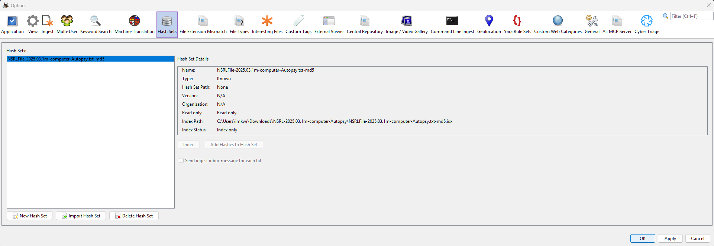
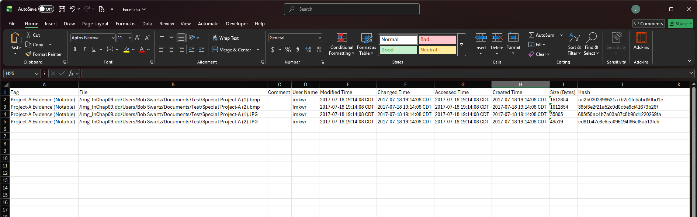
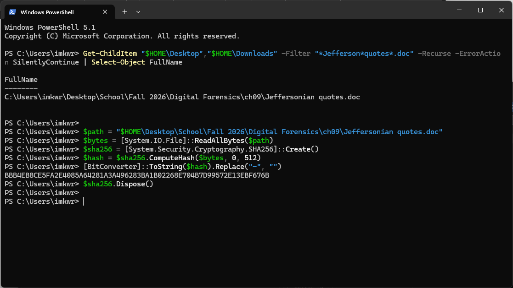
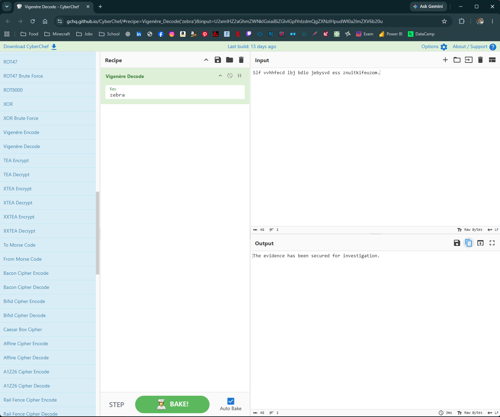

# df-mod4-tools
Digital Forensics Module 4 - Hash Databases, Hex Analysis, and Encryption
## Exercise 1: Importing a Known Hash Database

I downloaded and imported the NSRL hash database into Autopsy 4.23.1. I selected the Known hash set option because the database contains hashes of recognized files. This helps investigators identify common files and spend more time looking at files that might actually be evidence.

## Exercise 2: Hash Analysis and Evidence Tagging

I used Autopsy to examine the Chapter 9 disk image and identify files that could be relevant to the investigation. I tagged four Project-A images as notable evidence and generated an Excel report showing their file information and MD5 hashes. This helped me understand how hashing and tagging can be used to document digital evidence.

## Exercise 3: Hex Editor - Match File Remnants

I opened Jeffersonian quotes.doc in ImHex and selected the first sector (512 bytes). I used PowerShell to calculate the SHA-256 hash of those bytes.

This exercise helped me understand how investigators can identify pieces of deleted files that may still exist on a drive. Comparing hashes of file remnants can help determine whether recovered data matches known evidence.

## Exercise 4: Simple Encryption

For this exercise, I used CyberChef to encrypt and decrypt a message using the Vigenère cipher. I started with a simple message, encrypted it using the key "zebra", and saved the result as nothing.txt. I then used Vigenère Decode with the same key to recover the original message and saved it as recovered.txt.

Bit shifting moves the bits in binary data to the left or right. Although Vigenère encryption uses letter shifts rather than binary bit shifts, both demonstrate how data can be transformed. Understanding these techniques helps digital forensic investigators recognize hidden information and determine how to recover it.

